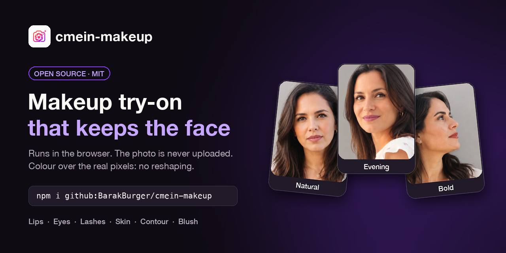
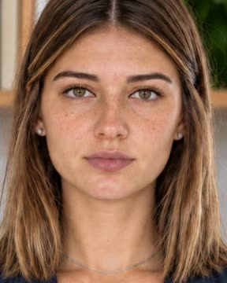
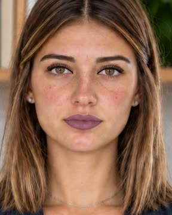
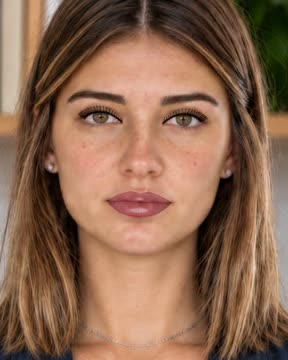
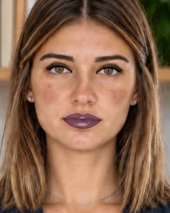

<p align="center">
  
</p>

<p align="center">
  <a href="https://github.com/BarakBurger/cmein-makeup/actions/workflows/build.yml"></a>
  <a href="LICENSE"></a>
  <a href="https://cmein.com/makeup"></a>
</p>

# cmein-makeup

Makeup try-on for the web that runs entirely in the browser. It finds the face, reads the skin
tone, and paints lipstick, eyeshadow, liner, mascara, brows, foundation, concealer, contour,
highlighter and blush onto the photo.

Two things set it apart:

- **The photo never leaves the device.** No server, no account, no upload.
- **The face is never reshaped.** Every product is colour laid over the original pixels through a
  soft mask, so lips, eyes and nose keep their real shape. The single deliberate exception is
  "fuller lips", capped at 7%.

It is the engine behind the free makeup tool at **[cmein.com/makeup](https://cmein.com/makeup)**,
published as-is.

## Quick start

```bash
npm install github:BarakBurger/cmein-makeup
```

```ts
import { detectFace, detectSkinTone, detectLipColor, defaultLook, renderLook } from 'cmein-makeup';

const photo = await createImageBitmap(file);            // any image the browser can draw
const found = await detectFace(photo);
if (!found.ok) throw new Error(found.reason);           // 'none' | 'several' | 'small'

// Start from the person's own skin tone and natural lip colour.
const tone = detectSkinTone(photo, found.points).index;
const look = defaultLook(tone, detectLipColor(photo, found.points));
look.lips = { ...look.lips, mode: 'bold', color: '#A4161A' };
look.eyes = { ...look.eyes, on: true, wing: true };

// renderLook paints over a canvas that already holds the photo.
const canvas = document.createElement('canvas');
canvas.width = photo.width;
canvas.height = photo.height;
canvas.getContext('2d')!.drawImage(photo, 0, 0);
renderLook(canvas, found.points, look);
```

Landmarks are normalised (0 to 1), so one detection serves a small preview and the full-size
download alike: draw the photo at any size, then call `renderLook` with the same points.

### Try the demo locally

```bash
git clone https://github.com/BarakBurger/cmein-makeup.git
cd cmein-makeup
npm install
python3 -m http.server 8000
```

Open http://localhost:8000/demo/, choose a photo, and switch between the original and all 17
looks. The page has to be served over HTTP, not opened as a file, because it loads modules.

## The 17 looks

The same ready-made looks as [cmein.com/makeup](https://cmein.com/makeup), quietest to heaviest,
shipped as `LOOK_PRESETS`. Each one starts from the person's own skin tone and lip colour. Every
photo below is this engine's output on one photo of the same model.

<table>
<tr><td align="center" valign="top" width="25%"><br><b>Everyday</b><br><sub>Barely there. Tidy brows, a little skin, your own lip.</sub></td><td align="center" valign="top" width="25%"><br><b>Natural</b><br><sub>Soft tint, a warm lid, a touch of blush.</sub></td><td align="center" valign="top" width="25%"><br><b>Glow</b><br><sub>No colour, just skin: bronzer, highlighter, a healthy flush.</sub></td><td align="center" valign="top" width="25%"><br><b>Beach day</b><br><sub>Sun on the cheeks, coral lip, nothing that melts.</sub></td></tr>
<tr><td align="center" valign="top" width="25%"><br><b>Work meeting</b><br><sub>Neutral lip, taupe lid, brows that hold the face.</sub></td><td align="center" valign="top" width="25%"><br><b>Job interview</b><br><sub>Quiet and even. Nothing the room will notice.</sub></td><td align="center" valign="top" width="25%"><br><b>Court</b><br><sub>The most neutral there is. Groomed brows, no colour.</sub></td><td align="center" valign="top" width="25%"><br><b>Baby shower</b><br><sub>Pastel and soft: sheer skin, champagne lid, pink lip.</sub></td></tr>
<tr><td align="center" valign="top" width="25%"><br><b>Birthday</b><br><sub>Glossy lip, rose gold lid, lashes on.</sub></td><td align="center" valign="top" width="25%"><br><b>Graduation</b><br><sub>A terracotta lip that survives a whole day of photos.</sub></td><td align="center" valign="top" width="25%"><br><b>Wedding guest</b><br><sub>Mauve lip, lilac lid, lashes. Dressed, never louder than the bride.</sub></td><td align="center" valign="top" width="25%"><br><b>Bridesmaid</b><br><sub>A softer bride: nude gloss, rose gold, coral blush.</sub></td></tr>
<tr><td align="center" valign="top" width="25%"><br><b>Bride</b><br><sub>Full but photograph proof. Dusty rose, champagne lid, real skin.</sub></td><td align="center" valign="top" width="25%"><br><b>Date night</b><br><sub>Brick lip with liner and gloss, warm lid.</sub></td><td align="center" valign="top" width="25%"><br><b>Evening</b><br><sub>Plum lid with a wing, berry lip.</sub></td><td align="center" valign="top" width="25%"><br><b>Bold</b><br><sub>Red lip, full lashes, sculpted cheeks.</sub></td></tr>
<tr><td align="center" valign="top" width="25%"><br><b>Red carpet</b><br><sub>Everything up: wine lip, smoked wing, full lashes.</sub></td></tr>
</table>

```ts
import { LOOK_PRESETS, defaultLook, renderLook } from 'cmein-makeup';

const look = LOOK_PRESETS.find(p => p.name === 'Date night')!.make(defaultLook(tone, naturalLip));
renderLook(canvas, points, look);
```

## What it needs

Nothing from CMeIn's servers. The first call to `detectFace` downloads Google's public
**MediaPipe Face Landmarker**: its code and WebAssembly from `cdn.jsdelivr.net`, and the model
from `storage.googleapis.com`. Both are cached by the browser afterwards. The photo itself is never
sent anywhere.

Tested in Chromium-based browsers (Chrome, Edge). It needs canvas 2D, ES modules and WebAssembly.
No dependencies at install time.

## API

| Function | What it does |
|---|---|
| `detectFace(image)` | Finds the face (478 landmarks). Resolves to `{ ok: true, points }` or `{ ok: false, reason }` |
| `detectSkinTone(image, points)` | Reads the skin from eight sample spots; returns the nearest of ten tones and the measured colour |
| `detectLipColor(image, points)` | The person's natural lip colour, a good starting tint |
| `defaultLook(tone, naturalLip)` | A complete look with every product off except a natural lip tint |
| `renderLook(canvas, points, look)` | Paints the look onto a canvas that already holds the photo |
| `alignTo(points, width, height, other, under?)` | Frames another picture of the same face like the original by matching the eyes, for before/after sliders |
| `loadLandmarker()` | Starts loading the face model early; `detectFace` calls it for you |

Ready-made looks: `LOOK_PRESETS`, each `{ name, note, make(base) }`. Shade lists ready for a
picker: `SKIN_TONES`, `LIP_SHADES`, `EYE_SHADES`, `BLUSH_SHADES`, `MASCARA_SHADES`, `BROW_SHADES`.

### The look

```ts
type Look = {
  tone: number;  // index into SKIN_TONES
  lips:   { mode: 'none' | 'tint' | 'bold'; color: string; liner: boolean; gloss: boolean; plump: number; strength: number };
  eyes:   { on: boolean; color: string; crease: boolean; wing: boolean; lashLine: boolean; oneEye: boolean; strength: number };
  lashes: { on: boolean; mascara: string; liner: boolean; falseLashes: boolean; brows: boolean; brow: string; strength: number };
  skin:   { on: boolean; coverage: 'sheer' | 'light' | 'medium'; underEye: boolean; blemishes: boolean; strength: number };
  sculpt: { on: boolean; contour: boolean; bronzer: boolean; highlighter: boolean; strength: number };
  glow:   { on: boolean; blush: string; healthyGlow: boolean; tan: boolean; strength: number };
};
```

`strength` is 0 to 100. Colours are hex strings.

## How it works

- **Finding the face.** MediaPipe returns up to four faces; the largest is the one the photo is
  of, and the rest are passers-by. Only two faces of about the same size are refused as ambiguous.
  In a full-length photo the face can be too small for the model, so it looks again at enlarged
  crops of the upper frame, where a standing person's face is.
- **Too small to make up.** Below about 50 pixels across, lips and lids are a few pixels each, so
  `detectFace` answers `small` instead of painting noise.
- **Painting.** Each product is a soft-edged mask built from the landmark groups (lips, lids,
  lash lines, brows, face oval, cheeks), filled with colour and blended over the original. Nothing
  is warped or redrawn.
- **Skin tone.** Sampled from forehead, between the brows and both cheeks, then matched to ten
  tones; foundation, concealer and contour shades are derived from the match.

## Limits

- **One person per photo.** Two faces of about the same size are refused as ambiguous
  (`reason: 'several'`); a bigger face with passers-by is fine.
- **Big enough to work on.** A face under about 50 pixels across is refused (`reason: 'small'`).
- **Network on first use.** The face model is downloaded the first time `detectFace` runs, so the
  very first call needs a connection.
- **The tone is a reading, not a fact.** `detectSkinTone` picks the nearest of ten tones from the
  pixels it sees; set `look.tone` yourself if your UI lets people choose.

## Links

### Use CMeIn

- [cmein.com](https://cmein.com) on the web, or the app on the
  [App Store](https://apps.apple.com/app/id6777321629) and
  [Google Play](https://play.google.com/store/apps/details?id=com.cmein.ai): realistic, candid
  photos of you from a handful of ordinary phone photos
- [Makeup try-on](https://cmein.com/makeup): this engine as a free tool, with an optional AI
  version
- [Pricing](https://cmein.com/pricing) and [the Wingman](https://cmein.com/wingman)

### Also from CMeIn

- [cmein-mcp](https://github.com/BarakBurger/cmein-mcp): connect CMeIn to Claude, ChatGPT, Cursor
  and other AI assistants

### Follow CMeIn

[Instagram](https://www.instagram.com/cmein.app/) ·
[Threads](https://www.threads.com/@cmein.app) ·
[Facebook](https://www.facebook.com/people/CMeIn/61590427634614/) ·
[YouTube](https://www.youtube.com/@cmein-ai/shorts)

## License

[MIT](LICENSE). The face model is Google's MediaPipe Face Landmarker, loaded at run time from
Google's servers under its own Apache 2.0 license; it is not included in this repository.
